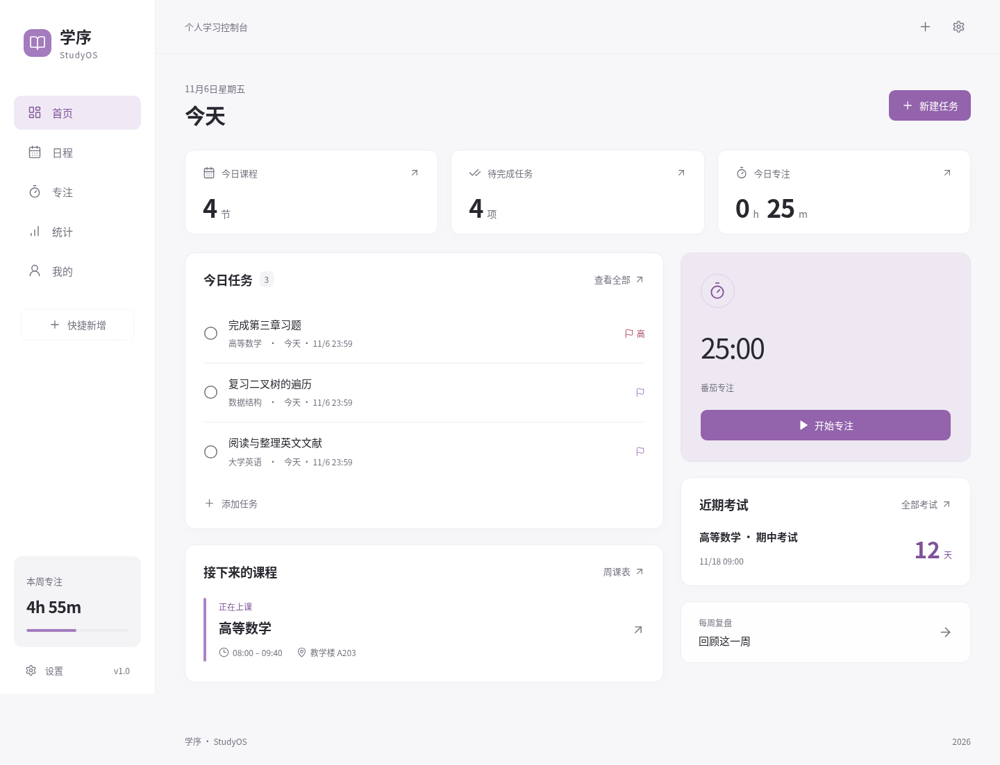
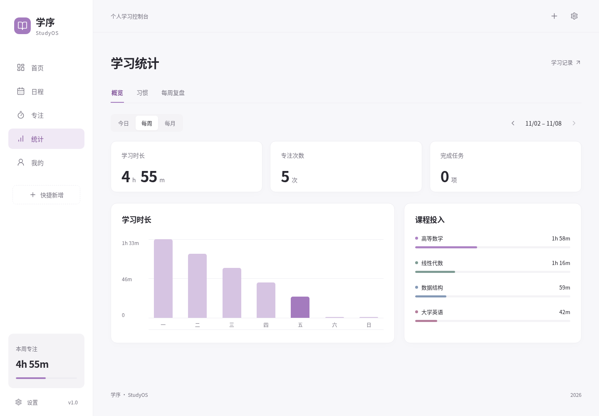
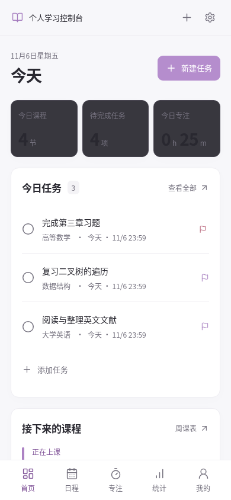
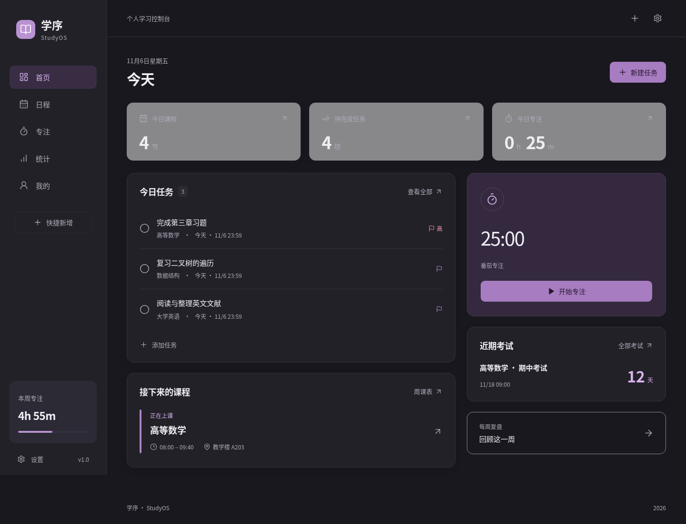

# 学序 StudyOS

大学生个人学习控制台。课程、任务、专注和学习记录放在一起，不需要账号或服务器。



## 功能

- **课程表**：学期和节次设置、多时段课程、教学周、单双周、重叠提示、单次停课、调课与加课。
- **任务**：作业、复习、待办、学习任务，支持子任务、优先级、截止时间、重复规则、完成和重新打开。
- **专注**：25 分钟番茄钟、5/15 分钟休息、自定义和正向计时。支持暂停、刷新恢复和课程/任务关联。
- **统计**：日/周/月学习时长、课程投入、热力图、历史记录修正和每周复盘。
- **考试与习惯**：考试倒计时、复习任务关联；完成/次数/时长型习惯、执行星期、历史打卡与日历。
- **自习与资料**：依据课程、考试和已安排任务计算空闲时段；课程文件、网页与 Obsidian 链接。
- **本地优先**：IndexedDB、文件随 JSON 备份迁移、原子恢复、数据库版本迁移、离线 PWA、浅色/深色/系统主题。

初次启动没有预置学习数据。可在「我的」中主动添加虚拟示例；已有学习数据时禁止添加。

## 开发

需要 Node.js 24（至少 22.12）和 npm。

```bash
npm ci
npm run dev
```

开发地址使用 `/StudyOS/` 子路径。无需任何密钥、账号或环境变量。

```bash
npm run typecheck
npm run lint
npm test
npm run build
```

浏览器测试：

```bash
npx playwright install --with-deps chromium
CI=true npm run test:e2e
```

Linux 已有系统 Chromium 时可直接 `npm run test:e2e`，或用 `CHROMIUM_PATH` 指定可执行文件。`npm run check` 会依次执行全部发布检查；端到端测试使用 `dist/` 的生产服务器，而非开发服务器。

## 架构

React + 严格 TypeScript + Vite；Dexie 管理 IndexedDB，`useLiveQuery` 将事务后的结果同步到页面。业务逻辑位于 `src/lib`，页面位于 `src/pages`，公共交互与编辑表单位于 `src/components`。

选用 CSS 变量和语义化原生表单，统一主题并减少 UI 框架依赖。图表由可访问的 HTML/CSS 渲染。Service Worker 在构建时按产物内容生成版本化应用壳，避免引入大型离线构建依赖。Lucide 提供统一图标，Zod 校验备份和写入。

使用 Hash 路由，页面刷新无需服务端路由回退。所有静态路径、Manifest 和 Service Worker 均使用 `/StudyOS/`，可部署在仓库子路径下。

### 时间规则

- 学期第一周从起始日期所在的周一计算，起始日前不显示循环课。单双周按教学周编号判断。
- 临时调整独立保存；撤销调整即可恢复循环课程。
- 重复任务在完成后生成一条后续任务。重新打开和再次完成不会重复生成。月度重复在目标月没有对应日期时取月末。
- 专注使用绝对时间戳和有效区间；后台结束时最多保存目标时长，暂停和休息不统计。多个标签页通过数据库事务避免重复保存。
- 统计按查看设备的本地日期拆分有效区间，跨午夜、夏令时和时区变化不会更改实际累计秒数。更换时区可能改变记录归属的日期。
- 自习时间在 08:00–22:00 内按至少 30 分钟空闲区间计算。考试暂按开始后 2 小时占用时间，任务按预计耗时安排，不做自动规划。

## 数据、备份和恢复

所有业务数据与上传文件保存在当前站点的 IndexedDB。主题也保存在本地数据库。应用不向 GitHub 或第三方上传学习数据；仓库与截图只有源代码和虚拟示例。外部资料链接仅在用户打开时访问。

在「我的 → 数据与备份」导出 JSON。备份含应用名、格式版本、全部实体和文件二进制编码，可跨设备导入。正在进行的计时请先保存。

- **合并**：按编号去重，相同编号保留本机内容。重复导入不重复累计；循环任务键与习惯日期也去重。
- **覆盖**：二次确认后替换全部本机数据。
- 导入先完整校验，写入在单一事务内执行；格式错误或写入失败会保留原有数据库。
- 支持 v1 备份转换和 v1 → v2 数据库升级，升级逻辑有集成测试。
- 单个课程文件限制 20 MB，备份导入限制 150 MB。超大资料建议使用外部链接并单独保管文件。

浏览器清理站点、隐私模式或磁盘配额限制都可能影响本地数据。可申请持久存储，但浏览器可能拒绝；请定期另存备份。没有自动跨设备同步。

## PWA 与离线

使用 HTTPS 部署（本机开发可用 localhost）。第一次联网打开后，静态资源会完整缓存，之后可离线启动、编辑数据和计时。

Android Chromium 通过浏览器菜单「安装应用 / 添加到主屏幕」，Windows Chrome/Edge 通过地址栏安装入口或浏览器菜单安装。平板可直接使用响应式页面。

检测到更新时，应用提示「更新并刷新」，正在计时时禁止更新。新 Service Worker 等待明确激活，完整缓存成功后才替换旧应用壳；缓存不包含学习数据。

专注声音需要一次用户操作以启用音频。系统休眠或浏览器挂起期间不保证及时响铃，也不宣称后台通知可靠；返回页面后会按时间戳结算。

## GitHub Actions 与发布

推送和 PR 会执行类型检查、ESLint、单元/集成测试、生产构建与 Chromium 端到端测试。CI 固定 Ubuntu 24.04，并使用运行器预装的 Google Chrome，避免安装不兼容的系统浏览器依赖。`main` 校验成功后部署 GitHub Pages；`v*` 标签校验成功后创建中文 Release 并附上生产构建 ZIP。

仓库需允许 GitHub Actions。Pages 使用 GitHub Actions 作为发布来源，工作流会尝试自动启用；若仓库策略拒绝启用，需要仓库管理员在 **Settings → Pages → Source → GitHub Actions** 开启后重跑部署任务。Release 工作流需要仓库授予 `contents: write` 权限。

生产构建位于 `dist/`，适合部署在 `/StudyOS/`。其他托管子路径需要同步调整 Vite 的 `base` 与 `scripts/build-pwa.mjs` 的 `base`。

## 截图

以下均为应用实际运行截图，使用虚拟示例数据。

| 桌面统计                                     | 移动首页                                 | 深色模式                               |
| -------------------------------------------- | ---------------------------------------- | -------------------------------------- |
|  |  |  |

测试范围和已知限制见 [验证记录](docs/VALIDATION.md)。MIT 许可。
